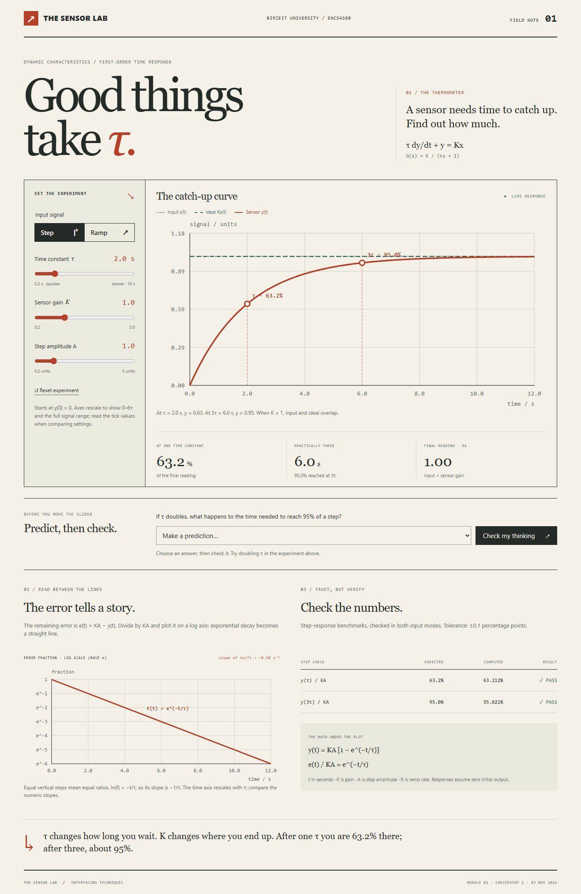
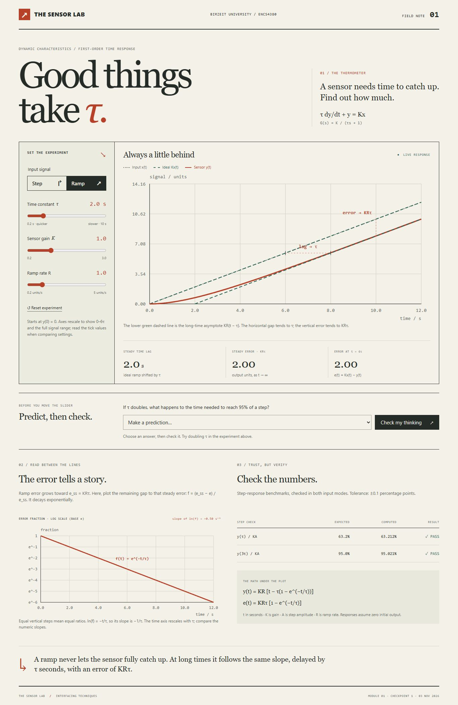
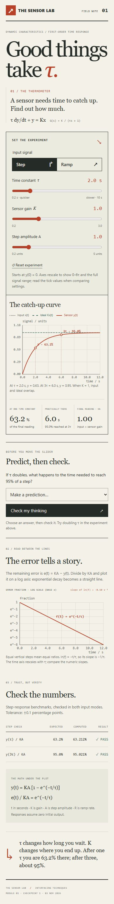

# Homework 1 — Sensor Lab

ENCS4380, Birzeit University. Checkpoint 1, November 3, 2026.

This is Module 1: a first-order sensor responding to a step or a ramp.
Move the sliders to change K, τ, and the input amplitude or ramp rate.
The page shows the response, the error on a log scale, and the lecture checks.

Pages address after publishing: https://ligux01.github.io/Homework-1/

## Run it

Open `index.html` in a browser. No installation needed.
For GitHub Pages, publish from `main` and `/ (root)` in Settings → Pages.

## Team

- Yazan Salhi
- Mohammad Shtayeh
- Mohammad Samer
- Ahmad Hamad — Module 1

## Equations

Starting from y(0) = 0:

- Step: `y(t) = K*A*(1 - exp(-t/tau))`
- Ramp: `y(t) = K*R*(t - tau*(1 - exp(-t/tau)))`
- Ramp steady error: `K*R*tau`; steady time lag: `tau`.

The step checks give 63.212% at τ and 95.021% at 3τ.
For a ramp, the log plot shows the remaining gap to the steady error.
Both log plots have slope `-1/tau` when plotting ln(error fraction) against time.
Axes rescale with the settings, so compare their tick values too.

## Screenshots

Used Codex to help with the layout, JavaScript, and formula checks.
