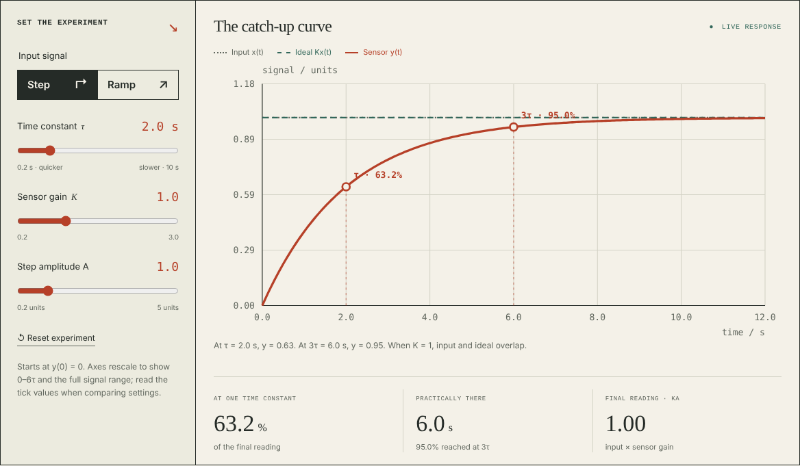
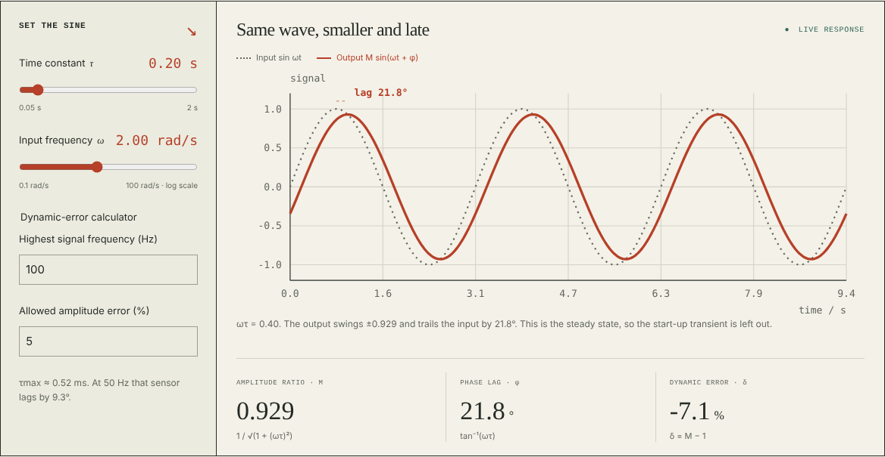
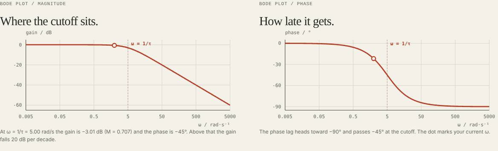
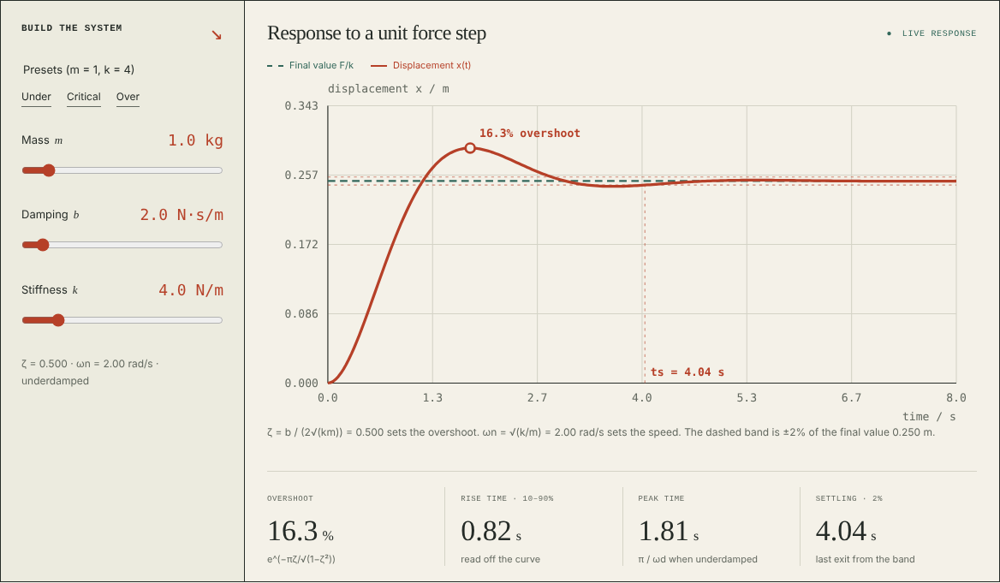
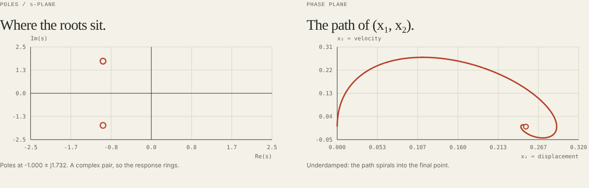
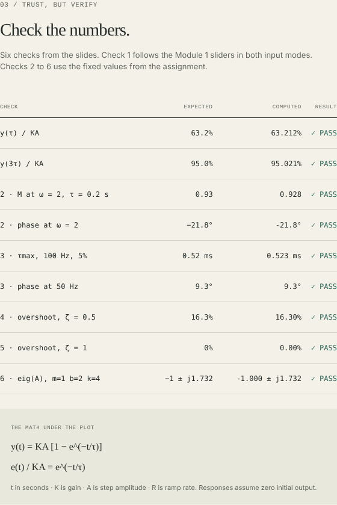
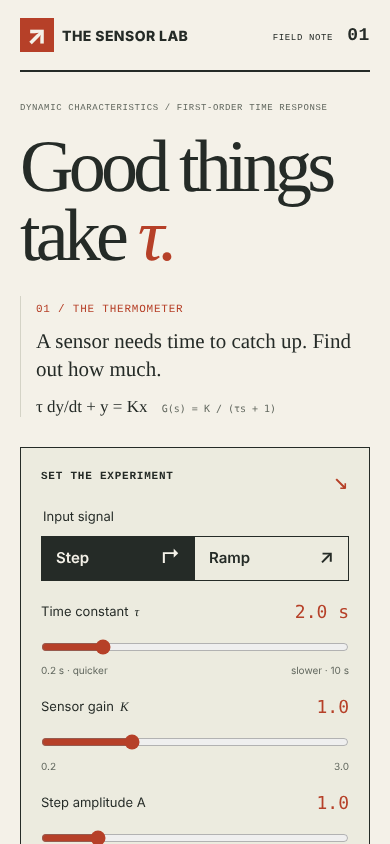
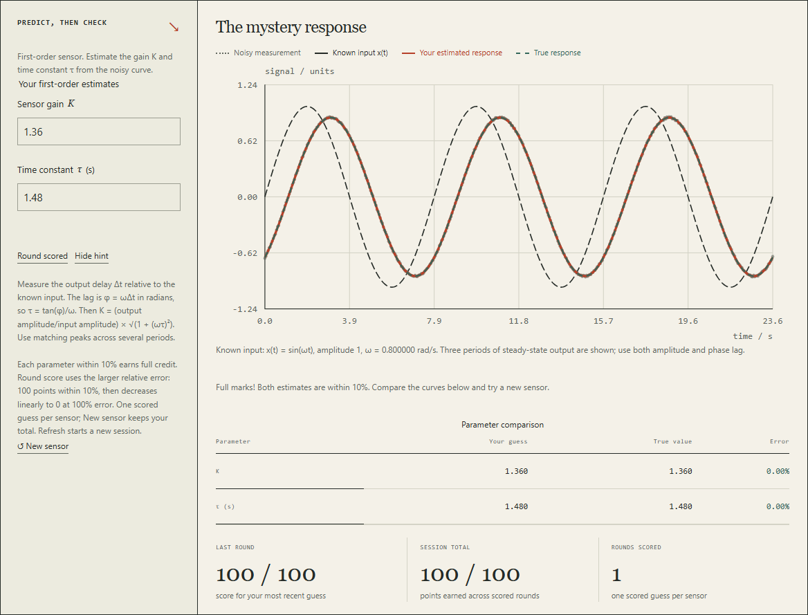

# The Sensor Lab: Dynamic Characteristics Toolkit

ENCS4380 Interfacing Techniques, Birzeit University. Homework 1, Dr. Wasel Ghanem.

A sensor never reports the present. It reports the past, smoothed. This site lets you move the sliders and watch how far behind a sensor gets, and why.

**Live site:** https://ligux01.github.io/Homework-1/

## Team

| Member | Student ID | Module |
|---|---:|---|
| Yazan Salhi | 1231057 | Module 1, first-order time response |
| Ahmad Hamad | 1230618 | Module 2, first-order frequency response |
| Mohammad Shtayeh | 1231028 | Module 3, second-order response and state-space panel |
| Mohammad Samer | 1232550 | Module 4, "Guess the sensor" challenge |

Each module has its own GitHub Issue, assigned to its owner.

## What is in it

**Module 1, first-order time response.** A thermometer modelled as τ·dy/dt + y = Kx. Pick a step or a ramp and move τ, K and the input size. The plot marks the 63.2% point at τ and 95% at 3τ for a step, and the lag and steady-state error for a ramp. A second plot shows the error fraction on a log axis, where it becomes a straight line with slope −1/τ.

**Module 2, first-order frequency response.** An input sine and the sensor's output on one plot, with the amplitude ratio, phase lag and dynamic error δ = M − 1 read live. Two Bode plots (gain and phase) mark the cutoff at ω = 1/τ and your current frequency. A dynamic-error calculator gives the largest τ that keeps the error under a limit for a given top frequency.

**Module 3, second-order response.** A mass-spring-damper with m, b and k sliders, plus Under, Critical and Over presets. Overshoot, rise time, peak time and settling time are read off the curve. The poles are drawn on the s-plane. A state-space panel shows A and B updating live, the eigenvalues of A next to the poles of G(s), and the (x₁, x₂) phase-plane path.

**Module 4, "Guess the sensor".** Each round creates a hidden random first-order or underdamped second-order sensor and adds small measurement noise. The user estimates K and τ, or ζ and ωn, from a step or sine response. The page then reveals the true values, overlays the estimated and true curves, reports each parameter error and scores the round. A hint button explains the appropriate estimation method, and the session score carries across new sensors.

Modules 1 to 3 each have a "Predict, then check" box: make a guess first, then test it with the sliders. Module 4 applies the same idea as a scored inverse problem.

## Validation checks

The page shows each check with the expected value, our value and pass or fail.

| # | Check | Expected |
|---|---|---|
| 1 | First-order step at τ and 3τ | 63.2% and 95.0% of KA |
| 2 | τ = 0.2 s, input sin 2t | amplitude 0.93, lag 21.8° |
| 3 | 100 Hz, at most 5% error | τmax ≈ 0.52 ms, 9.3° lag at 50 Hz |
| 4 | Second order, ζ = 0.5 | overshoot 16.3% |
| 5 | Second order, ζ = 1 | no overshoot |
| 6 | m = 1, b = 2, k = 4 | eigenvalues −1 ± j1.732, equal to the poles |

## Screenshots

## How it is built

Plain HTML, CSS and JavaScript. No libraries, no build step, no server. The plots are SVG drawn by `script.js` from the closed-form responses in the lecture slides. Nothing is simulated numerically, except that the second-order metrics are read off the curve by scanning it.

- `index.html` holds the page structure and every control.
- `style.css` holds the layout and the look.
- `script.js` holds the formulas, the plotting and the event wiring.

To run it locally, open `index.html` in a browser.

## AI use

We used Claude (Anthropic) for implementation support on Modules 2 and 3, the original README, and explanations of the JavaScript. We used ChatGPT/Codex (OpenAI) to help integrate and test Module 4, review the scoring and plotting logic, and explain the resulting code. The team reviewed the formulas, interactions and code and must be able to explain them during the demo.
